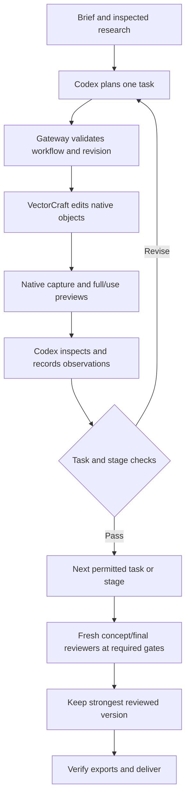

# How VectorCraft Studio works

The aim is to turn one large design problem into a sequence of inspectable decisions. Each step produces something concrete: a brief, a rough, a native edit, an image, a recorded observation, or an export.

## The whole journey

| Step | What happens | What is checked before moving on |
| --- | --- | --- |
| 1. Brief | Define the audience, message, medium, viewing size, and required wording | The design has an explicit purpose and exact copy |
| 2. Research | Inspect attributed references and describe useful principles | Sources were actually inspected; missing access stays disclosed |
| 3. Concepts | Develop three different ideas and reading experiences | Actual copy, hierarchy, scale, and negative space are considered |
| 4. Native roughs | In blockout profiles, build each idea in an isolated native document | Full and intended-size views are inspected; roughs stay separate from production |
| 5. Selection | A fresh concept reviewer assesses the alternatives | Selection has recorded image observations and remaining weaknesses |
| 6. Construction | Build composition, typography, imagery, and finishing | The current task and stage meet their applicable checks |
| 7. Final review | Two fresh reviewers inspect communication and craft | Candidate, retained best, and original are compared where applicable |
| 8. Correction | Address a consequential finding, inspect neighbors, then the whole scene | A local fix must preserve other important relationships |
| 9. Delivery | Verify the retained version, native editability, fonts, and current exports | Deliverable bytes match the reviewed version; limitations remain visible |

Rough means low detail. It does not require a low-poly visual style in the final artwork. The default uses concept alternatives and construction studies; three isolated native roughs are an additional blockout-profile requirement.

## Behind the scenes

**Codex** makes semantic decisions: what to build, which objects belong together, and what the images show. Reference notes help its reasoning; they are not the artwork document.

**The gateway** stores the workflow, task scope, document/specification revisions, object mappings, findings, review records, and export hashes. It permits or rejects workflow transitions. It cannot perfectly restrict an arbitrary engine command to a semantic region or prove that an image observation is true.

**VectorCraft** executes the native edits and produces paths, groups, live text, previews, and exports. Its object IDs identify concrete editable components.

**Fresh reviewers** receive actual image packets at concept and final review gates. They are separate model contexts, not a human panel. Their judgments are evidence of those model observations rather than proof of general quality.

## Choosing a profile

Choose `quality_profile` when starting a full workflow. Resume uses the saved profile. Quick mode is for small scoped edits and does not enable these experimental full-mode profiles.

| Profile | Native roughs before selection | Focused task acceptance | Explicit entity/relationship checks |
| --- | --- | --- | --- |
| `designer-v1` — default | No mandatory isolated three-rough set | Existing batch confirmation | Existing element mappings and visual inspection |
| `focused-execution-v1` | Inherited concept/construction studies | Yes | Existing mappings; no additional relationship graph |
| `layout-blockout-v1` | Three inspected isolated native roughs | Existing batch confirmation | Existing mappings |
| `designer-process-v1` | Three inspected isolated native roughs | Yes | Yes: semantic entities, anchors, dependencies, and observed relations |

All retain research, concept selection, construction studies, independent final review, and production checks. See [focused contracts](FOCUSED-EXECUTION.md) and [designer-process contracts](DESIGNER-PROCESS.md) for exact fields and restrictions.

## One manageable construction task

The builder reads the current **working packet** rather than repeatedly reconsidering the whole project. The packet identifies the task, relevant object IDs, current full/use previews, available details, applicable checks, unresolved findings, and next permitted action. Larger research/history records remain available by reference.

For a hand holding a tool, a task might say: make the fingers enclose the fixed handle; preserve the wrist route, shaft, and tip contact; inspect the grip, contact, and neighboring shapes. The builder plans that task, edits, captures, actually views the images, and records pass, revise, or blocked.

| Decision | Meaning |
| --- | --- |
| Capture recorded | Native bytes and images were saved; this does not approve them |
| Task passed | The small task's checks passed with observations |
| Stage accepted | Required elements and all stage checks are explicitly satisfied |
| Final review passed | The retained candidate met the required independent model review gate |
| Exports verified | Current exported bytes and production checks match the relevant version |

A component can pass while its stage remains unfinished. A revise preserves the evidence and queues a correction. Later stages wait for the required task to pass. Edits stale affected acceptance, relationships, and export readiness. Uncertain interrupted edits are inspected on resume and never replayed blindly.

## What each production stage asks

| Stage | Main question | Detail deferred |
| --- | --- | --- |
| Composition | Are placement, scale, reading order, and focal separation working? | Fine contours, surface detail |
| Typography | Is exact copy live, correctly set, and readable at intended size? | Optional decorative polish |
| Imagery | Are forms recognizable, proportionate, and correctly interacting? | Nonessential texture/detail |
| Finishing | Does the whole scene cohere, with consequential defects resolved and production ready? | Changes without a consequential reason |

Inapplicable checks require an explanation. Geometric bounds can flag suspicious distances or alignment; they cannot prove that a hand is gripping or that an illustration communicates well.

## A correction that needed its own correction

The recorded tyre-repair case is an example of why each change must be inspected. These descriptions come from its [creator report](../public-evidence/process-study-20261015/attempts/tyre-designer-process-v1-1/creator-report.json) and archived reviews, not a new evaluation.

1. The first finishing image had a nearly closed tyre contact and an opaque opening across the bench.
2. A planned correction opened the lip and exposed the gold tool shaft, but its first capture duplicated lower spokes and crossed the hub.
3. That capture received **revise**. A separate cleanup removed the duplicate originals and restored the hub, then inspected the neighbors and full/use images.
4. Fresh final reviewers preferred the corrected candidate without an observed consequential regression. A minor blunt lip termination remained disclosed. The retained version is `finishing-correction1-clean`.

Retained-best protection also matters when a correction does not win. In the library case, both reviewers judged the later candidate equal overall. The earlier candidate remained retained with its original unresolved acceptance. Verified files alone did not turn that attempt into a pass.

## What we currently know

**Implemented:** isolated roughs, compact focused packets, explicit task/stage checks, and revision-bound relationships for the full experimental profile.

**Technically tested:** state transitions, artifact binding, legacy isolation, installation behavior, and native integration recorded in their dated reports. Fixture tests do not assess aesthetics.

**Recorded image observations:** individual construction and correction outcomes, including failures and unresolved weaknesses. Explore them in [progress and stage comparisons](research/PROGRESS.md).

**Still pending:** eight builds, formal cross-profile preferences, owner responses, standardized editing evaluation, and broader validation. Comparative quality improvement is unestablished. Proposed extensions and post-study repairs remain in the [roadmap](COARSE-TO-FINE-ROADMAP.md) and [execution notes](research/EXECUTION-NOTES.md).
