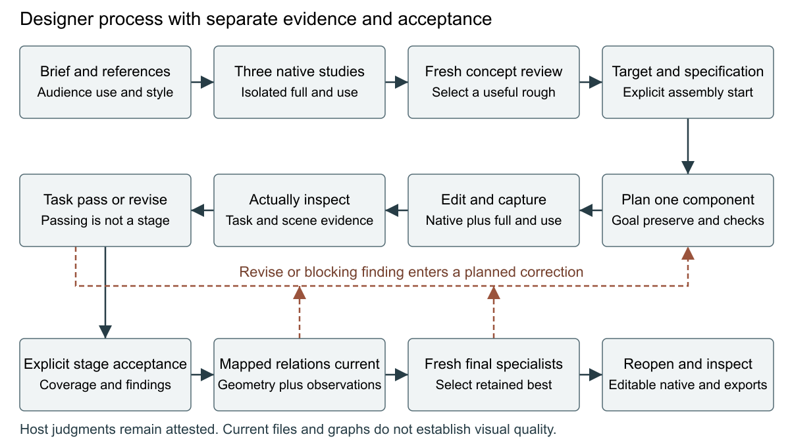

# Evaluating a designer process for native vector authoring agents

VectorCraft Studio research programme

Interim development manuscript 15 October 2026

## Abstract

We implement an experimental control policy for native vector authoring that makes early composition studies explicit and gives a builder a limited task during construction. Three isolated native blockouts precede independent concept selection; subsequent tasks carry preservation requirements, observable checks and revision-bound object mappings. Separate spatial and construction graphs describe meaningful parts, while captured evidence, task acceptance, stage acceptance and final independent selection remain distinct. The contribution is a workflow and reliability layer around an existing host model and vector editor. It is not a new graphics engine or trained model. Software checks establish policy and integration behavior. Completed poster and information-graphic calibrations demonstrate observed corrections, independent selection, live text and editable native reopening. A disrupted illustration calibration remains an unconfirmed partial result. A separately identified final attempt completed with an observed imagery correction and minor residual sleeve ambiguity. The approved eighteen-trial matched pilot is underway. This interim edition records ten of eighteen attempts: four final-review passes, one verified library delivery with unresolved quality acceptance, four interrupted attempts without final artwork and one default illustration with confirmed imagery but unconfirmed finishing. The owner deferred the eight remaining builds. A completed tyre-repair illustration retained an observed correction, a failed correction capture, fresh final reviews and editable native reopening. Protocol exposure and an unsupported extra contact attestation remain disclosed. Cross-condition and owner comparisons are pending. Overall quality improvement, professional preference and human comprehension remain unestablished.

## Problem and research question

Native artwork creation requires coordinating communication, composition, drawing, typography and production. A single broad instruction to improve the whole scene gives the builder several competing objectives and makes a correction difficult to assess. A hand can sit close to a tool without visibly gripping it; an attractive connector can imply the wrong information relationship; polishing local detail can weaken reading order. Valid files and many editable objects do not resolve these failures.

The owner proposed establishing placement and scale first, making a rough native rendering, then constructing smaller parts progressively. We translate that idea into an explicit experimental policy. Decomposition is meaningful rather than uniform: a hand and held tool may belong to one tightly connected task, while foliage can be separate. Whole-scene checks remain necessary after local work.

The primary research question is whether the complete process improves common-brief suitability at matched construction cost compared with the current designer-v1 workflow. Secondary questions concern consequential defects, editability, production failures and effort. The first pilot evaluates the method as a bundle; it does not attribute effects separately to focused acceptance, graph declarations, enforcement or retrieval.

## Related work and borrowed principles

Design Council describes alternating exploration and focused development, grounded in people's needs and iterative testing. AIGA's educational development guidance motivates thumbnails and roughs. Preising's practitioner account connects briefing, references, concept development, descriptive feedback and delivery. These sources inform the operational sequence; they are not empirical demonstrations that this agent policy works. Our supplied audience descriptions remain assumptions until evaluated with people. [Design Council](https://www.designcouncil.org.uk/resources/framework-for-innovation/), [AIGA](https://www.aiga.org/sites/default/files/2021-03/3E_DesignProcess_DesignDevelopment.pdf), [Preising](https://randypreising.com/illustration-process/).

VisPainter is a close editor-agent precedent, using specialized roles and element-level manipulation for editable scientific illustrations. The practical mcpInkscape account is also relevant to structured edits, review and export evidence. PaperVizAgent, formerly PaperBanana, combines reference retrieval, planning, styling, generation and critique. Broad claims about agents controlling editors or iteratively reviewing graphics therefore do not define our novelty. None of these external systems is an invented executed baseline here. [VisPainter](https://arxiv.org/html/2510.27452v1), [mcpInkscape](https://tspi.at/2026/09/13/llminkscape.html), [PaperVizAgent](https://github.com/google-research/papervizagent).

FigTree decomposes scientific figures into local SVG programs, exposes occupied bounds and named connection ports, assembles fragments, and inspects both program and render during repair. Hierarchical semantic SVG parsing addresses structural grouping and practical editing. GeoSVG-RL uses executable geometry in a training-based diagram system. We borrow useful representations and diagnostic ideas while keeping a sequential native builder. Declared relationships and bounds do not inherit those systems' learned capabilities or published outcomes. [FigTree](https://arxiv.org/html/2609.01006v1), [hierarchical SVG parsing](https://arxiv.org/html/2609.14657v1), [GeoSVG-RL](https://arxiv.org/html/2605.25447v1).

Constrained refinement research reports that syntactic success and visual quality can diverge and that additional refinement is not reliably beneficial. AesEval examines localized, multidimensional graphic-design judgments; TASTE separates professional design preferences and reports model–designer disagreement. These findings motivate preserving incumbents, bounding corrections, retaining failures and separating dimensions of evaluation. They do not validate our model reviewers against people. [Constrained refinement](https://arxiv.org/html/2608.28678v1), [AesEval](https://arxiv.org/html/2603.01083v1), [TASTE](https://arxiv.org/html/2605.20731v3).

The planning review screened sixty search-result entries across four workstreams and read relevant sections of twelve primary sources. It is a targeted review, not an exhaustive systematic search or freedom-to-operate assessment. Bibliographic metadata was refreshed on 13 October; the AIGA PDF refresh failed and its earlier planning inspection is identified separately. The maintained source/principle matrix and BibTeX record preserve attribution and boundaries.

## System ownership and method

The host model supplies language reasoning, image observations, optional image generation and fresh reviewer contexts. Upstream VectorCraft supplies the native editor, live typography, renderer and import/export operations. The maintained Python companion contributes five workflow tools, records, revision checks, isolated connections, recovery and production gates. Its default remains designer-v1; experimental profiles are opt-in full-mode policies. Historical v1/v2 helpers and run contracts remain unchanged.

| Condition | Inherited designer workflow | Early isolated native studies | Focused task and stage acceptance | Relationship evidence |
| --- | --- | --- | --- | --- |
| designer-v1 | Yes | Existing concept/construction requirements | Existing behavior | Existing specification checks |
| layout-blockout-v1 | Yes | Three registered blockouts and explicit transition | Existing behavior | Existing specification checks |
| designer-process-v1 | Yes | Three registered blockouts and explicit transition | Explicit component tasks and stages | Current mapped relation observations and diagnostics |

The inherited workflow already includes inspected research, reference calibration, three developed directions, independent concept review, a target/specification, a representative construction study, four production stages, independent final specialists and exports. It is the strong same-host baseline, not a deliberately weak one-shot generator.

Figure 1. Implemented control sequence and correction return. Tasks, stage coverage, relationship evidence and final independent selection are distinct. The diagram describes orchestration, not a learned model or a measured quality gain.

### Purpose and early alternatives

A design_brief records audience, message, intended response, viewing context, medium, production requirements, shared style, assumptions and exact required copy. Three layout alternatives state concepts, reading order, negative space, copy and normalized placements. Each becomes an isolated native study with two or three observable checks. Temporary roughness tests hierarchy, proportion or a critical interaction; it does not require a faceted final style.

Study calls route through a child connection with separate document, revisions and recovery. Production remains preserved. Capturing records native/full/use evidence. The host actually views both images before confirming pass, revise or blocked. A revise cannot close as passed and requires another planned correction. Closing a study does not complete any production stage.

Three closed passed studies must match the current layout record. Direction IDs match layout IDs and thumbnail bytes match the corresponding study. Fresh concept review covers all registered full/use images and calibration references before selection. The selected target and specification precede an explicit assembly transition that opens the chosen immutable blockout in production. This transition is single-use before production edits.

### Meaningful parts and focused construction

The complete profile declares entities with current specification bindings, working/supporting roles, optional parents and named anchors normalized against native bounds. A construction dependency graph must be acyclic; spatial relationships may form cycles. The gateway validates declarations, but it does not automatically discover useful parts, schedule every dependency, or solve semantic attachments. The host chooses construction order and owns cross-component interactions.

Each task has one component or tightly connected group, a goal, affected semantic entities, preservation requirements and two or three observable checks. A compact working packet supplies the current task, relevant native IDs, current scene preview/detail evidence, applicable checks, unresolved findings and next permitted action. Research/history remain available by reference. The builder works from that packet rather than reopening every project decision during each batch.

Acceptance distinguishes evidence capture from passing a task and completing a stage. Composition checks placement/scale, reading order and focal separation. Typography checks exact copy, live text/font integrity and intended-size readability. Imagery checks recognizable forms, proportions and critical interactions. Finishing checks cohesion, consequential visible defects and production readiness. An inapplicable check needs a reason. Stage completion requires explicit acceptance, required specification coverage and resolved blocking findings; later detail is deferred.

### Relationship checks and correction

The host maps every declared graph entity to real native object IDs in a current confirmed capture and inspects full/use/target images. Anchor distance, alignment and containment supply geometric diagnostics. Grip, contact, association and occlusion require visible judgments. A geometric diagnostic failure cannot be overridden as a pass, but passing geometry never proves meaningful contact.

Failed relationships enter an ordered consequential correction queue. A task addresses one finding, preserves captured evidence, then checks affected neighbors and the whole scene. Known native changes invalidate incident relationship acceptance using mapped node fingerprints, ancestor properties and order. Unmapped or global changes invalidate broadly. Specification or target changes require renewed inspection and graph reconciliation. Stage and export acceptance remain separate from these local checks.

The invalidation algorithm is deliberately conservative. It can identify byte-level changes relative to saved native objects; it cannot infer every visual dependency, guarantee semantic-region isolation, or certify that an unrelated-looking edit has no perceptual effect. Arbitrary engine commands remain available within planned batches, so scope is guidance followed by inspection.

### Recovery and delivery

Resume restores production and active study contexts separately. An uncertain operation blocks its owned context and is never replayed. Original artwork remains preserved. Independent communication and craft reviewers inspect actual neutral candidate/incumbent/target images. Common-brief suitability selects the retained version separately from target fidelity. At most three final correction rounds are allowed, with a stop after two non-improving rounds.

Delivery reopens the retained native document, inspects editability and live text where applicable, and observes exports at intended size. Read-only final verification starts no extra authoring workflow and grants no additional correction budget. An outlined print SVG may preserve glyph appearance while the native source retains live text; optional live SVG dependencies are disclosed.

## Verification and calibration evidence

Software fixtures test profile isolation, malformed/oversized checks, intermediate batches, revise/correction, explicit stage acceptance, stale evidence, real mappings, blocked preflight and resume. Native integration checks exercise independent study routing, production preservation and recovery. Synthetic fixture observations are not image-tool evidence. The first implementation milestone passed 198 checks; the current Python 3.13 self-contained/native suite passed 216 checks, including study isolation, recovery, reporting and separately scoped native editing. Verification is required before installation. Passing counts do not establish artwork quality.

The completed first-cycle poster used four actually inspected cached references and three new native alternatives. One observed final correction joined the hand/forearm to the torch and refined boots. Fresh final specialists preferred candidate-v2, with no remaining consequential findings reported. Twelve planned batches used 26.077 active minutes and 8.890 minutes of independent-review waiting. Fresh read-only native reopening verified six live text objects, 61 editable paths and matching before/after native bytes. Parent inspection also observed legible title/footer and a connected torch-beam scene at 450×600. This is local model-observed feasibility.

The poster's initial concept packet omitted use images. A supplemental review inspected them after the first composition edit and retained the selection. Original evidence and timing are preserved, and the episode does not count as prospective compliance. New experimental concept validation now requires both sizes. An external live-SVG renderer also substituted a font; the primary outlined SVG and optional live SVG limitation are recorded.

The first illustration calibration stopped budget_exhausted with one unconfirmed study. Last settled tool evidence was 285.656 seconds after start, while total charged wall time reached 34,922.422 seconds with no review pause. The intervening gap is undiagnosed. No independent review, final stage acceptance, exports or reopening occurred. Prospective wall/monotonic diagnostics improve future evidence without refunding or accepting this partial result. All failures remain in the calibration record. The separately identified second and final illustration calibration passed both fresh specialists. An imagery task first returned revise for a radio-cavity shadow collision and an off-table plant; a planned correction resolved both. Ten batches used 25.069 active minutes after Session creation and 11.570 minutes of review waiting. Fresh reopening verified 143 editable paths, three groups and no raster or text content. The wordless artwork retained an ambiguous supporting sleeve and lacked an optional bag cue. All native and export image observations, malformed-record rejections and rendering differences remain recorded.

The first information-graphic calibration retained finishing-v1 after both fresh final specialists passed it, with a minor uptake-arrow/branch overlap. An observed early correction moved a sunlight arrow away from a label; native roots and water-route associations were inspected. Nine batches used 17.110 active minutes after Session creation and 8.815 minutes of review waiting. Reopening verified 17 live text objects, 52 native paths and exact Arial fonts. Directions recorded intended rather than all actual rough supporting sentences; the discrepancy and transcripts remain preserved, and prospective native text-coverage validation now rejects that omission. No measured human comprehension result follows from these observations.

## Approved controlled pilot

Three fresh briefs concern a book-exchange poster, cooperative bicycle-tyre repair, and a fictional library decision graphic. Three conditions and two fresh-context builds per condition produce eighteen outcomes. The campus/community domain is intentionally restricted; three briefs are the independent task units. Repeats and model judgments are correlated.

The freeze records code commit/files, exact briefs, attributed cached reference pack, model/settings metadata, dimensions and input hashes. Builds occur in randomized order with one fresh active builder at a time. Trial feedback is not transferred to later builders. All conditions receive the same reference/tool access and locked content. Seven cached image assets represent six source works and fall short of the broader 15–25-work target; fresh viewing is required. The frozen protocol overcounted works, and an explicit correction preserves its original wording and input hashes. Root metadata exposes gpt-6.1-sol with high reasoning effort; missing per-agent receipts remain a provenance limit.

Each build has 60 wall-active minutes and 24 planned batches including early studies and corrections. The shared ledger starts before builder dispatch, including research, planning and initialization; calibration's local Session timings are not directly compared with holdouts. Identical frozen prior guidance is supplied to every condition; mutable vault retrieval and calibration/pilot feedback are excluded during held-out builds. Only explicit independent-review waiting is paused. In-flight operations settle without uncertain replay. Timeouts, disruption, exhaustion and unavailable results remain accounted for. Instrumented adapter calls, planned batches, active time and review waiting are separate measures. Startup/restore, internal native calls and read-only verification are not included in that call count; token telemetry is unavailable unless exposed by the host. The adapter assumes honest host use rather than acting as a secure sandbox.

After all outcomes are accounted for, twelve anonymous paired comparisons evaluate the complete method against default and blockout-only separately. Left/right positions are balanced and order randomized using a frozen map. Fresh communication and craft judges receive the common brief and equal full/use images with sanitized structure, excluding condition, creator rationale, scores and target. Target-based construction reviews and these common-brief comparisons answer different questions.

Before actual comparison collection, a separate reporting safeguard binds the neutral index, packet, brief, image and inspection bytes plus the private map digest. Changed or missing bound inputs block analysis. This safeguard changes neither frozen authoring behavior nor preference criteria; hashes establish byte consistency, not authenticated perception.

Identical subsequent editing tasks run on separate copies with ten minutes/four batches: change poster date and move details; move the wheel while preserving hand/tool contacts; exchange two information branches while retaining correct endpoints/associations. Native structure and actual before/after images assess practical editing. Missing source artworks are reported rather than excluded.

The operational gate requires both fresh specialists and the owner's blind preference to agree on improvement in at least four of six default pairs spanning two genres, with no consequential regression in the remaining pairs. Blockout comparisons are reported separately. This is a development decision, not a population significance result. Pilot production has begun; comparative judgments and owner responses have not yet occurred. Interruptions have reduced the available comparison evidence without establishing a process or aesthetic disadvantage.

At the interim five-attempt checkpoint, three poster builds completed and two full-process attempts exhausted their allowances after host interruptions. The completed default, blockout-only and full-process posters used 9/13/12 planned batches and 75/101/164 instrumented calls respectively. Shared charged active time through parent accounting was 12.878/29.401/20.546 minutes; this includes post-stop verification, reporting and parent overhead and is not solely authoring time. These are unmatched interim observations, not a condition estimate. All three passed their own fresh final reviews and native reopening. A saved-selection recovery defect observed in the blockout-only attempt was resolved through preserved known metadata plus a planned finishing edit; no frozen source was patched. Exactly 16.564 seconds of invalid review pause were reclassified as active overhead. The full-process poster retained final exports but lost superseded intermediate SVG/PDF bytes. EXECUTION-NOTES.md and original records preserve these limitations.

At the eight-attempt checkpoint, the full-process tyre illustration also completed, while two additional interruptions exhausted attempts without artwork, including one before Gateway initialization. The illustration used twelve planned batches, 325 instrumented calls and one final correction round. Shared charged active time was 21.472 minutes; the active interval until workflow stop was 17.051 minutes, with 13.674 minutes of valid review waiting. Initial concepts were rejected for supporting-arm/tool ambiguity. A second exploration clarified those relationships. Final reviewers then identified loop-like tyre contact and an opaque wheel opening. An observed correction opened the lip and revealed the bench through spokes; a retained revise capture exposed duplicate spokes/crossed hub, repaired in a separate planned batch. Both fresh final reviewers preferred the corrected candidate, retaining a minor lip-contour weakness. Native reopening verified 57 editable paths and no raster/text. This is model-observed local feasibility. An unsolicited cross-trial completion-status exposure is a protocol deviation, and an extra wheel-bench relation passed by attestation lacks clear physical contact evidence. Neither is removed from the records or treated as a validated relationship.

The ninth attempt, a default tyre illustration, exhausted the shared allowance before finishing confirmation at approximately 60.350 active minutes. Three accepted stages and an unconfirmed finishing capture remain, without final reviews, exports or reopening. Nine planned batches and 84 settled receipts were recorded. An invalid review pause with no waiting reviewer was fully counted active, preserving original events; its long post-expiry gap inflates charged time through parent accounting to 491.353 minutes and must not be interpreted as construction time. Three already missing full-process production results limit possible default-pair agreement to three of six. Thus this pilot cannot establish the frozen four-of-six release gate. Remaining attempts, comparisons and edits still proceed without a threshold change or inference of aesthetic inferiority from missingness.

The tenth attempt, a library blockout graphic, delivered verified native and export files with unresolved acceptance. Nine batches and 245 settled receipts used 10.856 charged active minutes. The retained version's initial communication distinctiveness score of 3 prevented pass. A correction received two fresh equal common-brief votes and applicable candidate scores of 4; retained-best correctly stayed unchanged, with one non-improvement. No consequential correction remained, yet the frozen gateway had no honest voluntary-stop route below its automatic thresholds. The creator ended authoring externally, and the attempt is recorded failed/quality-unresolved with active gateway bytes preserved. Fresh native reopening verified nine live phrases, 33 editable paths, three branch groups and exact fonts; native/SVG/PDF full/use images were actually viewed. This exposes a stopping-policy limitation rather than an absent artwork or exhausted allowance.

At the owner's request, this edition publishes the ten-attempt checkpoint and defers the eight remaining builds. No comparative or subsequent-edit outcomes are supplied. Publication of these outputs creates additional exposure before later owner preference collection; guaranteed human blinding must not be claimed. A voluntary unresolved stop, persistent saved-selection recovery and selection-independent text preflight remain proposed post-study repairs. None retroactively changes the frozen evidence.

## Limits and next evidence

Image paths, hashes and observation fields do not authenticate perception. Fresh reviewer contexts are not independent human experts, and can share model biases. Reviewer IDs are not signed identity evidence. Hashes detect changes relative to stored records; a dishonest actor can rewrite files and metadata. Current PDF/export checks do not universally certify every production property.

Anonymous owner packets omit conditions and creator history, but progress reports, known failed attempts and stylistic differences can permit condition inference. This is anonymous presentation, not guaranteed human blinding. Reader comprehension tasks will withhold answer-bearing briefs until recognition/comprehension responses are recorded; later brief-based preference is a separate measure.

Useful graphs can impose overhead or freeze a weak rough prematurely. Too many tiny tasks may fragment coherent contours or consume time needed for composition. More detail can reduce clarity. The pilot must record these negative possibilities as well as successes. A complete-policy gain would justify further ablation, not establish that every added mechanism helps.

Broader briefs, cross-model replication and a designer/reader panel are later gates. Reader tasks should measure event information, repair-action recognition and branch comprehension before preference questions. Owner feedback is only the first human checkpoint. A separate memory-transfer experiment is needed before calling vault note storage learning. Default promotion, the larger 54-output study, public submission and general professional-superiority claims remain outside this first programme delivery.

## Reproducibility and artifacts

Maintained contracts, frozen pilot preparation/collection scripts, tests, held-out briefs, source/principle matrix, BibTeX, claims, calibration and append-only log are versioned. Private originals remain in project-local work/outputs directories. The interim sharing package includes selected owned production captures/exports, sanitized creator and visible model-review records, all eighteen outcome rows and source/public artifact hashes. It excludes credentials, private configuration, raw sessions/vault notes and cached third-party reference images. Sanitized records are derivatives, not complete restorable workflow directories; original input bytes and host access remain necessary for exact reproduction. Installed engine binaries remain external and separately required.

The historical paper in docs/peer-review is an immutable dated report of an earlier state. This manuscript records the new programme and its current evidence; it does not retrofit historical results. The full controlled pilot and human gates are required before converting its pending hypotheses into comparative conclusions.

## Automation disclosure

Research, coding and documentation were performed with Codex under the owner's instructions. Model agents author the experimental artworks and model reviews; those reviews are labeled model observations. Owner preference and later professional/reader responses are collected separately. No interviews, participant responses, external reproductions or unavailable telemetry are invented.
